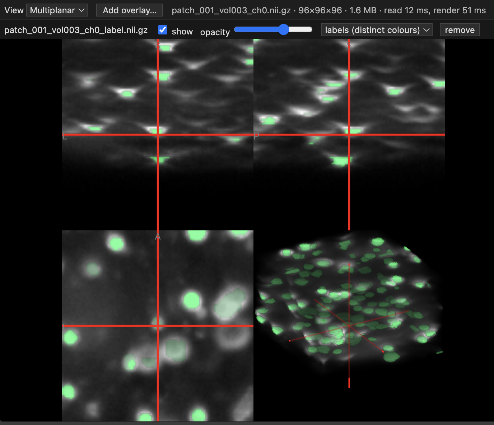

# Volume Viewer for VS Code

View 3D medical images right inside VS Code: no downloading, no switching apps.
Works on your own computer and on remote servers over Remote-SSH.



## What you can do

- Open `.nii` and `.nii.gz` files in a VS Code tab
- See axial, coronal, sagittal and 3D views at once, or pick just one
- Click anywhere to move the crosshair and see the voxel value
- Add one or more overlays, like segmentation labels or predictions
- Adjust each overlay's colour and opacity, hide it, or remove it

## Install

1. Get the `vscode-volume-viewer.vsix` file.
2. In VS Code, right-click it and choose **Install Extension VSIX**.
3. Reload the window when asked.

## Use

1. Right-click a `.nii` or `.nii.gz` file and choose **Open With… → Volume Viewer (remote-safe)**.
2. Use the **View** menu to switch between views.
3. Click **Add overlay…** to put a label or other image on top.

**Tip:** to open images with a plain double-click, choose
**Open With… → Configure default editor…** and pick **Volume Viewer (remote-safe)**.

## Build it yourself

You need [Node.js](https://nodejs.org). Then run:

```bash
npm install
npm run build
npm run package
```

This creates `vscode-volume-viewer.vsix`.

## Credits

Images are drawn with [NiiVue](https://github.com/niivue/niivue).
