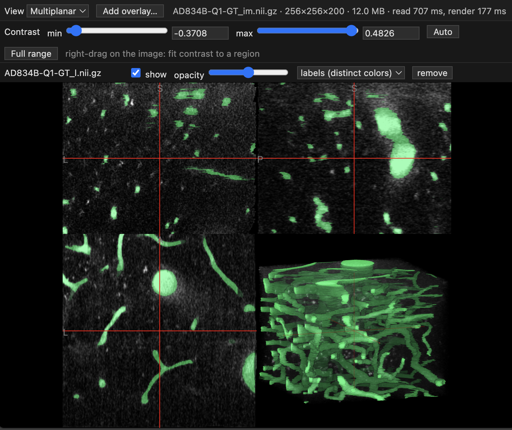
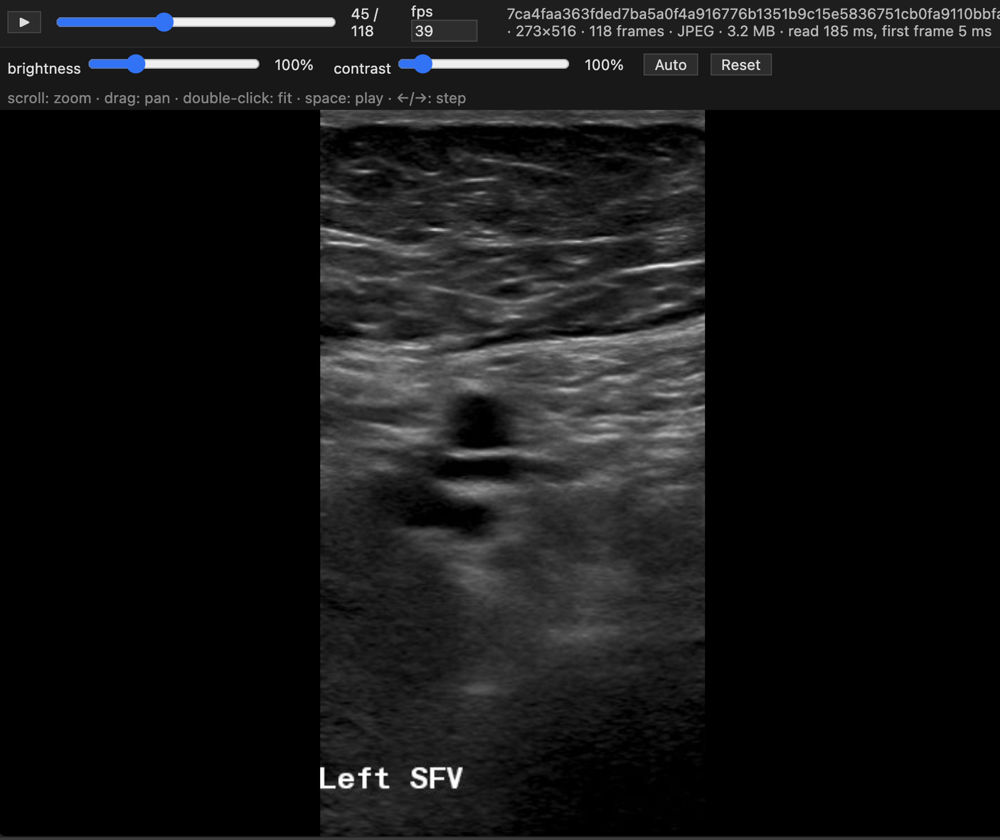

# Volume Viewer for VS Code

View medical images right inside VS Code: no downloading, no switching apps.
Works on your own computer and on remote servers over Remote-SSH.

 

## What you can do

- **3D images** (NIfTI, or DICOM CT/MR): axial, coronal, sagittal and 3D views, contrast with an **Auto** button, and label overlays with their own color and opacity
- **Ultrasound and other DICOM clips**: play, pause and step through frames, adjust brightness and contrast, zoom and pan

## Install

In VS Code, open the **Extensions** panel, search for **Volume Viewer (remote-safe)**, and click **Install**.
If you use Remote-SSH, install it while connected.
On the extension's page, check **Auto Update** so you always have the latest version.

## Use

- **Open a file:** right-click a `.nii`, `.nii.gz` or `.dcm` file → **Open With… → Volume Viewer (remote-safe)**.
  Clicking one slice of a DICOM series opens the whole series.
- **Open a DICOM folder:** right-click the folder → **Open DICOM folder in Volume Viewer**.
- **Add an overlay:** click **Add overlay…**.

**Tip:** to open files with a double-click, choose **Open With… → Configure default editor…** and pick **Volume Viewer (remote-safe)**.

## Build it yourself

With [Node.js](https://nodejs.org) installed, run `npm install`, `npm run build` and `npm run package`.
This creates `vscode-volume-viewer.vsix`.

## Credits

Images are drawn with [NiiVue](https://github.com/niivue/niivue); DICOM conversion uses [dcm2niix](https://github.com/rordenlab/dcm2niix).
See [THIRD_PARTY_NOTICES.md](THIRD_PARTY_NOTICES.md) for all licenses.

## License

[MIT](LICENSE)
